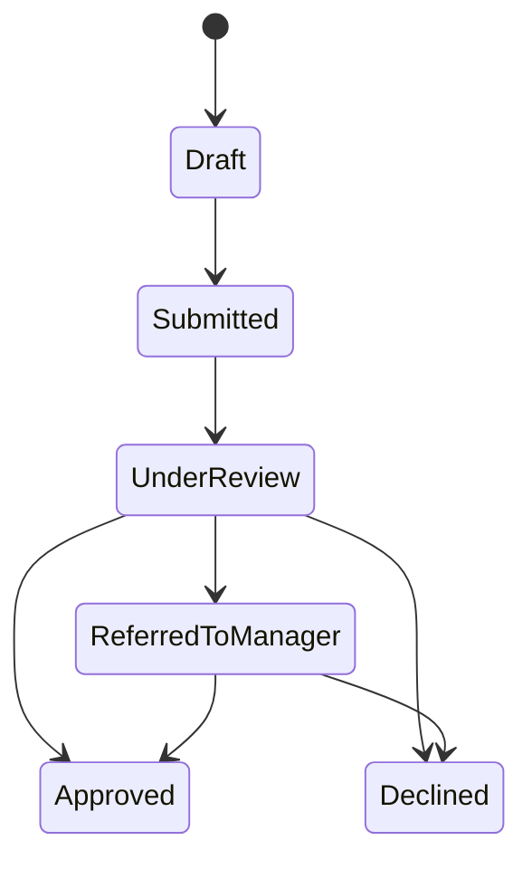

# LoanWorkflow

A desktop app for handling loan applications, built with C#, .NET 10, Windows Forms and Entity Framework Core. Someone applies for a loan, a set of rules checks the application and gives a recommendation, and then an assessor or manager makes the final call. Every step gets written to an audit trail so you can see who did what and when.

I'm building this as a portfolio project to get more practice with business rules, workflows and clean layering in .NET. It's still in progress, so the status section below is honest about what's done and what isn't.


# Where it's at

**Working now**
- The data model (users, loan applications, audit entries) and the first EF Core migration
- A loan repayment calculator
- A rules engine with two rules, credit score and affordability
- 15 unit tests, all passing

**Still to do**
- The workflow state machine that controls which status changes are allowed
- The application service that handles submit, review, approve and decline, with role checks and audit logging
- Login with hashed passwords
- The WinForms screens
- CI with GitHub Actions

## How it works

An application moves through a fixed set of statuses, and it can't skip steps:



When an application is checked, each rule comes back with Pass, Refer or Fail and a short message explaining why. The decision engine then combines them. If any rule fails, the overall result is Fail. If none fail but at least one says Refer, it's Refer. Otherwise it's Pass. The assessor sees the overall result and the individual messages together.

There are four roles. Applicants can create and submit their own applications. Assessors review them. Managers can do everything an assessor can, plus make the final decision on referred cases. Admins manage users.

### The rules

- **Credit score:** 650 or above passes, 550 to 649 gets referred for a manual look, anything below 550 fails.
- **Affordability:** fails if the monthly repayment is more than half of what's left of the applicant's income after expenses and existing debt payments.

These numbers are just examples I picked to have something to test against. They aren't real lending policy. They're passed in as parameters, so I can make them configurable later.

## Project layout

LoanWorkflow.Core     entities, rules and the calculator (no dependencies)
LoanWorkflow.Data     EF Core DbContext and migrations
LoanWorkflow.UI       the WinForms app
LoanWorkflow.Tests    xUnit tests

The reason for the split is that the business logic in Core doesn't know anything about the database or the UI, so I can test it without either. Data and UI both depend on Core, and nothing depends on UI.

A few choices worth explaining:

- Money is `decimal` everywhere. I didn't want floating-point rounding anywhere near a repayment calculation.
- Each rule is its own class behind an `ILoanRule` interface, so adding a new rule doesn't mean touching the engine.
- Statuses and roles are stored as text in the database, so the rows are readable when I'm poking around.
- Users who have applications or audit entries can't be deleted. I didn't want the audit trail to lose its history.

## Running it

You'll need the .NET 10 SDK and Windows, since it's a Windows Forms app. I've been using Visual Studio.

```bash
git clone https://github.com/SmangalisoMathebula/LoanWorkflow.git
cd LoanWorkflow
dotnet build
```

To create the SQLite database from the migrations:

```bash
dotnet tool install --global dotnet-ef
dotnet ef database update --project LoanWorkflow.Data --startup-project LoanWorkflow.UI
```

To run the tests:
bash
dotnet test


## Notes

All the sample data is made up, so please don't put real personal or financial details into it. Passwords will be hashed with BCrypt, and the role checks will live in the service layer so they don't depend on which buttons the UI happens to show. The local database file is git-ignored.

There's no licence yet. I'll add one before making the repo public.

# Author

Smangaliso Mathebula, [@SmangalisoMathebula](https://github.com/SmangalisoMathebula)
